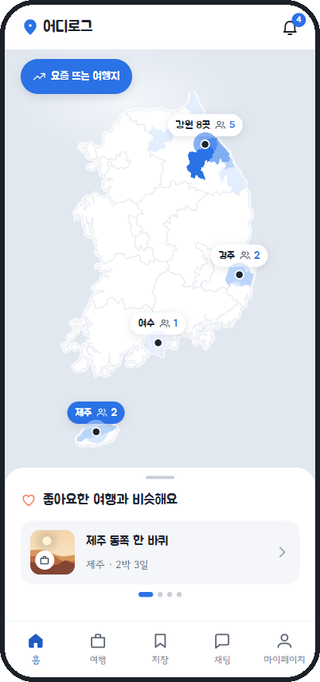
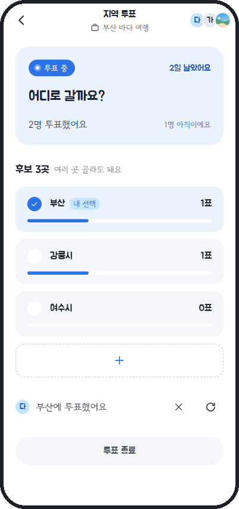
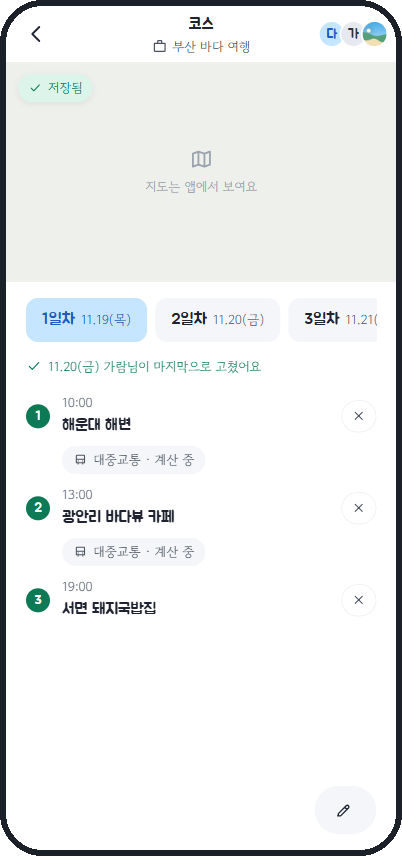
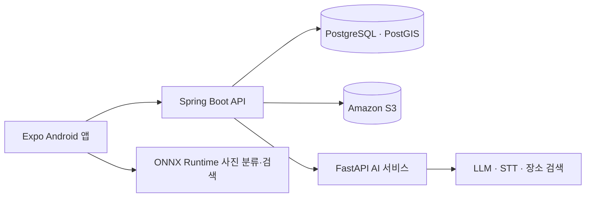

# 어디로그 EodiLog

**친구들과 장소를 모으고, 투표로 결정하고, 함께 일정을 짜는 Android 여행 앱.**

6인 팀 프로젝트 · 2026.10–2026.11

단체 채팅에 묻히는 맛집 링크부터 여행 후 사진과 정산까지, 여행 전후에 흩어지는 작업을 하나의 여행 공간에 모았습니다.

| 장소와 여행 탐색 | 동행 투표 | 날짜별 코스 |
|:---:|:---:|:---:|
|  |  |  |

화면은 앱의 테스트 데이터로 촬영한 웹 미리보기입니다. 지도 타일은 네이티브 앱에서 표시됩니다.

## 여행 흐름

| 단계 | 할 수 있는 일 |
| --- | --- |
| 모으기 | 초대 링크로 동행을 모으고, 링크와 캡처에서 찾은 장소를 개인 또는 그룹 보관함에 담습니다. |
| 정하기 | 동행이 저장한 장소와 여행 취향을 바탕으로 후보를 추천받고, 투표로 여행지와 방문 장소를 결정합니다. |
| 함께 짜기 | 저장한 장소로 날짜별 코스를 제안받고 동행과 수정합니다. 여행 중에는 날씨 대안과 준비물도 확인할 수 있습니다. |
| 남기기 | 사진을 주제별로 정리하고 문장으로 검색합니다. 공동 경비를 기록하면 인원별 정산 금액을 계산합니다. |

## AI 포트폴리오 · 장수철

팀에서 AI를 담당했습니다. FastAPI 기반 기능 API와 Spring 백엔드 간 연동 계약을 설계하고, 장소 추출·사진 분류 평가와 온디바이스 모델 경량화, 음성 입력 기능을 개발했습니다.

| 과제 | 구현과 검증 |
| --- | --- |
| 링크·캡처의 장소를 지도 후보로 연결 | 모델은 입력에서 장소명과 단서를 추출하고, 지역 검색 결과를 장소 후보로 연결합니다. 합성 캡처 50장 평가에서 장소명 재현율은 **93.1–95.4%**였습니다. 이 수치는 장소 검색을 끈 추출 단계 기준이며 두 번의 실행에서 화면 오독이 총 5건 발생했습니다. [평가 리포트](ai/docs/reports/capture-eval.md) |
| 휴대폰에서 사진 분류와 한국어 문장 검색 | SigLIP2 교사 모델의 분류와 이미지·문장 유사도를 작은 모델에 증류하고, 이미지 인코더는 int8, 문장 인코더는 4비트로 양자화했습니다. 모델을 **1,438MB → 191MB**로 줄였고, 학습에 쓰지 않은 평가 사진 1,931장 기준 **분류 정확도 97.4%**, **검색 Top-5 77.7–78.5%**를 기록했습니다. 분류 정답은 모델 판정이 일치한 라벨을 사용했습니다. [실험 리포트](ai/docs/reports/ondevice-photo-ai.md) |
| 음성으로 공동 경비 초안 만들기 | 녹음을 받아쓰고 금액·결제자·분담 대상을 구조화합니다. 받아쓰기에서 근거를 확인할 수 있는 값을 사용하고, 사용자가 확인할 초안으로 반환합니다. [음성 경비 코드](ai/app/features/voice_expense) · [음성 여행 계획 실험](ai/docs/voice-trip-experiment.md) |

## Android 실기기 검증

Galaxy S22의 합성 사진 990장에서 정리 버튼을 누른 뒤 검색 준비까지 **319.02초 → 20.65초**가 걸렸습니다. 캐시를 남기고 앱을 다시 열었을 때 990장의 임베딩을 모두 재사용했습니다. 사진 10장을 추가한 실험에서는 새 사진만 인코딩했고, 총 1,000장 중 새 카드키 사진이 검색 1위였습니다.

[단풍 검색 실기기 영상](portfolio-verification/android-cache/real-device/eodi-autumn-search.mp4) · [1,000장 검색 화면](portfolio-verification/android-cache/real-device/eodi-autumn-result.png) · [실측 보고서와 CSV](portfolio-verification/android-cache/real-device/REPORT.md)

조건별로 한 번씩 측정한 개발 빌드 결과입니다. 모델 품질 수치와 실기기 지연의 측정 조건은 [포트폴리오 브리프](portfolio-verification/PORTFOLIO-BRIEF.md)에 정리했습니다.

## 시스템 구성



- 모바일은 React Native, Expo Router, TypeScript, TanStack Query, Zustand를 사용합니다. 소개·초대 페이지는 React와 Vite로 구성했습니다.
- 백엔드는 Spring Security, JPA, Flyway와 STOMP WebSocket을 사용합니다. 오래 걸리는 AI 요청은 PostgreSQL 작업 큐에 등록하고, 앱은 작업 ID로 상태를 조회합니다. [작업 큐 설계](EodiLog/docs/plan/jobs-foundation.md)
- AI 서비스는 기능별 입력·출력과 상태를 정의합니다. 좌표와 이동 시간은 지도·경로 API 결과를 사용하고, 장소와 일정 변경안은 사용자가 확인한 뒤 적용합니다. [AI API 명세](ai/docs/spec.md)

## 로컬에서 살펴보기

**앱 화면 미리보기**는 `frontend/`에서 아래 순서로 실행합니다. `.env`에 `EXPO_PUBLIC_DEV_MOCK=true`를 설정하면 서버 없이 테스트 데이터로 주요 흐름을 볼 수 있습니다. 실제 Android 동작은 개발 빌드에서 확인합니다. [프론트엔드 설정](frontend/README.md)

```bash
cd frontend
npm ci
cp .env.example .env
npm run build:android
npm start
```

| 구성 요소 | 실행 및 테스트 |
| --- | --- |
| `EodiLog/` | Java 25와 Docker를 준비하고 `.env.example`을 참고해 설정합니다. `docker compose up -d`로 DB를 띄운 뒤 `./gradlew bootRun --args='--spring.profiles.active=local'`로 실행합니다. 테스트는 `./gradlew build`입니다. |
| `ai/` | Python 3.11과 uv를 준비하고 `.env.example`을 참고해 설정합니다. `uv sync --group dev` 후 `uv run uvicorn app.main:app --reload`로 실행합니다. 테스트는 `uv run pytest`입니다. |
| `frontend/` | `npm test`, `npm run typecheck`, `npm run lint`로 검사합니다. |
| `deploy/` | 컨테이너와 서비스 환경 설정은 [배포 문서](deploy/README.md)를 참고합니다. |

## 팀

| 장수철 | 전성환 | 황승기 | 정인경 | 박세은 | 윤영광 |
| --- | --- | --- | --- | --- | --- |
| AI | 백엔드 | 백엔드·인프라 | 프론트엔드 | 프론트엔드 | 프론트엔드 |
