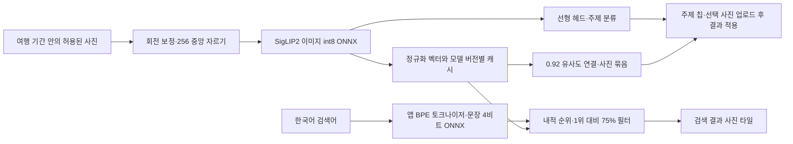

# 어디로그 포트폴리오 검증 · 온디바이스 여행 사진 검색

2026-11-25 · 공개 커밋 `592d2351` · [AI 기능 전수 목록](AI-INVENTORY.md)

## 대표로 고른 이유

**사진을 폰에서 분류하고 한국어 문장으로 찾는 기능**을 추천한다. 모델 학습·경량화, 앱의 입력·출력 경로, 모델 품질과 실패를 설명할 자료가 모두 남아 있고, 이번에 실제 가중치로 추론을 재현했다. 장소 추출은 외부 모델과 장소 공급자까지 연결한 신규 시연이 필요하다. 음성 경비는 앱과 API가 연결되어 있으나 독립 코퍼스 결과를 확인하지 못했다. 일정 추천은 공급자 응답과 제약 검증이 필요하고, 개인 역할 근거는 현재 AI 측 휴리스틱에 집중돼 있다.

**장수철 구현 근거**는 모델 제작 스크립트·리포트 `03277461`, 앱 사진 분류·검색 `ae314b33`, Spring 기기 결과 수신 `09174325`, 캐시와 모델 크기 검증 `af7ebff0`이다. 서버 분류 모델·API는 `921602bd`, `94a78ba1`, `fa508962`이고 서버 적용 흐름에는 황승기 `36fd7d67`이 있다. 커밋은 원본 팀 Git에서 확인했다. 모델·앱·서버 통합을 하나의 개인 작업으로 귀속하지 않는다. [훈련 및 평가 기록](../ai/docs/reports/ondevice-photo-ai.md)

## 입력에서 결과까지

앱 경로는 마이페이지 → 내 사진 찾기 → `PhotoSearchScreen` → `useGalleryAi` → `GalleryAiPanel`이다. 앱 코드로 검색어를 받아 벡터화하고 사진 타일을 만드는 흐름을 확인했다. 데스크톱에서는 같은 모델 파일과 앱의 토크나이저·정렬·필터 소스를 실행했다. 사진 전처리는 Android `ImageManipulator` 대신 Pillow로 등가에 가깝게 구현했다. Android 렌더러와 JPEG 디코더의 미세한 차이는 포함하지 않는다. [검색 화면](../frontend/src/features/ondevice/screens/photo-search-screen.tsx) · [모델 실행](../frontend/src/features/ondevice/engine.ts) · [검색·타일 구성](../frontend/src/features/ondevice/use-gallery-ai.ts) · [순위 규칙](../frontend/src/features/ondevice/search-rules.ts)

### README와 대조

| README 설명 | 코드와 이번 실행에서 확인한 사항 |
| --- | --- |
| 한국어 문장으로 폰 안에서 사진 찾기 | Android 앱은 로컬 사진과 ONNX 런타임으로 처리하도록 구현됐다. 같은 모델과 앱 검색 로직을 Windows CPU에서 실행해 정답 사진을 열었다. 기기 갤러리 권한·비행기 모드·화면 탭은 이번에 재실행하지 못했다. |
| 1,438MB → 191MB, 분류 97.4%, 검색 Top-5 77.7–78.5% | 기존 리포트의 모델 비교와 1,931장 평가에 해당한다. 읽어 온 네 모델 파일은 `model-spec.ts`의 바이트 수와 일치했다. 두 ONNX 파일의 합은 191.0 MiB이고 헤드·토크나이저 포함은 약 192.2 MiB다. 새 평가는 다른 60장의 합성 데이터다. |
| 사진 주제 분류와 묶기 | 기기 결과 처리·분류기를 실행했고, 실제 서버 분류 API도 호출했다. 유사 사진 묶음 품질과 업로드 후 DB 반영은 이번 정량 집계 범위에 포함하지 않았다. |

## 분류 재실행

`verification.md`에 기록된 AI 생성 사진 60장, 디렉터리 주제 라벨 각 15장, 유사 변형 쌍 포함. 이 60장은 초기 주제 문장 선택에도 쓰였다. 별도로 존재하는 `labels.json`과 `sources.csv`는 77장 Wikimedia 세트의 ID를 사용하므로 이번 디렉터리 이미지의 라벨로 쓰지 않았다. 두 모델 모두 폴더 라벨 일치로 집계했다. 실제 사용자 사진이나 독립 테스트 세트의 정확도로 일반화할 수 없다. [기존 합성 세트 라벨·조건](../ai/docs/verification.md) · [기존 Wikimedia 평가](../ai/docs/reports/photo-classification-eval.md)

| 기대 주제 | 수량 | 기기 ONNX 모델 / Windows CPU | 실제 서버 API / Windows CPU |
| --- | ---: | ---: | ---: |
| 풍경 | 15 | 15/15 | 15/15 |
| 음식 | 15 | 15/15 | 15/15 |
| 사람 | 15 | 14/15 | 14/15 |
| 기타 | 15 | 14/15 | 14/15 |
| 전체 | 60 | **58/60 (96.7%)** | **58/60 (96.7%)** |

두 경로에서 안내판 `o06`(기타)과 뒤에서 찍은 두 사람 `p03`(사람)이 풍경으로 분류됐다. 둘 다 실외 배경이 있는 유형이지만, 모델의 판단 원인을 실험으로 분리하지는 않았다. 서버 경로는 `POST /ai/v1/photo-classifications`를 FastAPI `TestClient`에서 실제 multipart 요청으로 호출했다. SigLIP2 `ViT-B-32-SigLIP2-256`의 캐시된 기본 가중치와 공개 커밋의 파인튜닝 가중치·헤드를 로드했다. 모델 응답을 모킹하지 않았다. 8장 워밍 배치는 1.83–2.17초였고, 정상 JPEG와 손상 데이터를 같이 보낸 요청은 첫 호출 32.25초, 재호출 0.33초였다. 이 시간에는 네트워크·Spring 큐·앱 렌더링이 포함되지 않는다. [분류 원시 결과](photo-results.json)

## 한국어 검색 재실행

같은 합성 사진 60장과 사전에 지정한 질문 8개. 파일 시나리오에 따라 정답 ID가 있는 질문 4개, 앨범에 해당 장면이 없는 질문 4개로 구성했다. 기존 리포트에 기록된 **최대 60장 유사도 순 노출**을 같은 실제 임베딩과 순위 함수에서 상대 필터만 끈 방식으로 재현했다. 정답 열기는 반환된 정답 ID로 로컬 JPEG를 찾아 실제로 디코딩한 결과다. 지연은 이미지 인덱싱 완료 후 질의 시작부터 데스크톱 하네스의 순위 반환까지이며 Node 프로세스 기동과 직렬화가 들어간다. 사진 열기와 Android UI의 입력 디바운스·렌더링은 미포함이다. [원시 결과와 두 방식의 순위](onnx-results.json) · [기존 필터 설명](../ai/docs/reports/ondevice-photo-ai.md)

| 질문 | 기대/정답 열기 | 필터 전 → 현재 결과 수 | 현재 1위 | 무정답 사진 반환 | 데스크톱 경과 |
| --- | --- | ---: | --- | --- | ---: |
| 바다 위로 지는 해 | `l11-a`, `l11-b` / 둘 다 열림 | 60 → 5 | `l11-b` | 적용 대상 아님 | 488.2 ms |
| 그릇에 담긴 비빔밥 | `f04` / 열림 | 60 → 2 | `f04` | 적용 대상 아님 | 462.7 ms |
| 벚꽃이 늘어선 길 | `l12-a`, `l12-b` / 둘 다 열림 | 60 → 2 | `l12-a` | 적용 대상 아님 | 463.4 ms |
| 가격이 적힌 식당 메뉴판 | `o04`, `o13` / 둘 다 열림 | 60 → 2 | `o04` | 적용 대상 아님 | 499.2 ms |
| 눈 위의 북극곰 | 없음 | 60 → 3 | `p01` | 있음 | 516.1 ms |
| 수중에서 헤엄치는 고래 | 없음 | 60 → 1 | `f09` | 있음 | 500.9 ms |
| 발사대에서 이륙하는 우주 로켓 | 없음 | 60 → 1 | `p08` | 있음 | 429.4 ms |
| 에펠탑 앞에 세워진 빨간 소방차 | 없음 | 60 → 2 | `o08` | 있음 | 460.1 ms |

두 방식 모두 정답 질문 Top-1 4/4, 정답 사진 7/7 열기 성공, 무정답 질문에 결과 반환 4/4였다. 상대 필터를 적용하면 노출 합계가 480장 → 18장으로 줄고, 무정답 질문에서 노출된 사진은 240장 → 7장으로 줄었다. 정답 질문 중 바다와 비빔밥 질의에는 지정한 정답 이외 사진도 남았다. 데스크톱 하네스 경과는 429.4–516.1ms, 중앙값 475.8ms였다. 필터 전후 별도 지연은 측정하지 않았다.

## 정상과 실패 증거

- **정상** · `그릇에 담긴 비빔밥` → 앱 `SiglipTokenizer` → ONNX 문장 임베딩 → `rankBySimilarity`·`relevantOnly` → `f04` 1위. `f04` JPEG 디코딩에 성공했다. 실제 앱에서는 훅이 이 결과를 검색 타일에 전달한다. [정상 결과 이미지](normal-result.png)
- **실패** · `수중에서 헤엄치는 고래` → 같은 코드 경로 → `f09` 해산물 시장 사진만 반환. `relevantOnly`는 최고 점수 대비 비율을 사용한다. 최고 점수가 양수일 때 1위는 기준을 만족하고, 0 이하인 경우도 함수가 전체 입력을 반환한다. 이 코드는 정답 유무 판정을 하지 않으므로 결과가 적어도 무정답으로 확정할 수 없다. [실패 결과 이미지](failure-result.png)
- **파일 오류 처리** · 서버 `router.py` → `PhotoClassifier.classify` → `_decode_all` → `_failed`. 정상 `f01`은 `SUCCEEDED/FOOD`, 손상 `bad-01`은 `FAILED/IMAGE_DECODE_FAILED`, 요청 HTTP 상태는 200이었다. 같은 요청에서 정상 사진 결과를 확인했다. [라우터](../ai/app/features/photo_classification/router.py) · [서비스](../ai/app/features/photo_classification/service.py) · [실제 응답](photo-results.json)

증거 이미지는 실행 JSON에서 만든 카드다. 안드로이드 기기가 연결된 상태가 아니었고, 이번 공개 커밋에 대응하는 실행 APK가 확인되지 않아 **실제 앱 화면 캡처와 온디바이스 종단 간 지연은 확보하지 못했다.** 웹 엔진은 네이티브 추론을 실행할 수 없다. 기존 Galaxy S10 기록은 별도 사진실험 앱의 기록이다. 이번 자료에는 내부 모델 파일·원본 사진·개인정보를 넣지 않았다.

## How + Result 제목 3개

1. **SigLIP2를 증류하고 이미지 int8·문장 4비트로 줄여, 여행 사진 검색 모델을 1,438MB에서 191MB로 경량화** · 기존 모델 리포트.
2. **한국어 문장과 사진을 같은 벡터 공간에서 비교해, 합성 앨범 검색에서 정답 질문 4개 모두 첫 결과로 적중** · 새 데스크톱 재현.
3. **최고 점수 대비 75% 필터로 사진 노출을 480장에서 18장으로 줄이고, 정답 없는 질문 4건에서 반환 한계 확인** · 같은 사진과 질의로 기존 순위 노출 방식과 비교.

## 실행 자료

[서버 평가 스크립트](run_photo_eval.py) · [ONNX 평가 스크립트](run_onnx_eval.py) · [증거 이미지 생성 스크립트](render_evidence.py)

서버 스크립트 인수는 공개 커밋에서 추출한 `ai/` 디렉터리, 평가 사진 디렉터리, 출력 JSON 경로 순서다. Python 환경에 FastAPI, HTTPX 및 저장소의 `vision` 의존성, Hugging Face 모델 캐시가 필요하다. ONNX 스크립트 인수는 모델 파일 디렉터리, 같은 사진 디렉터리, 출력 JSON 경로 순서다. Python에 ONNX Runtime·Pillow·NumPy, 그리고 TypeScript를 실행할 수 있는 Node 24가 필요하다. 앱 코드 두 파일은 로컬 Git의 `592d2351`에서 직접 읽는다. 모델 파일별 SHA-256은 원시 결과에 기록했다.
